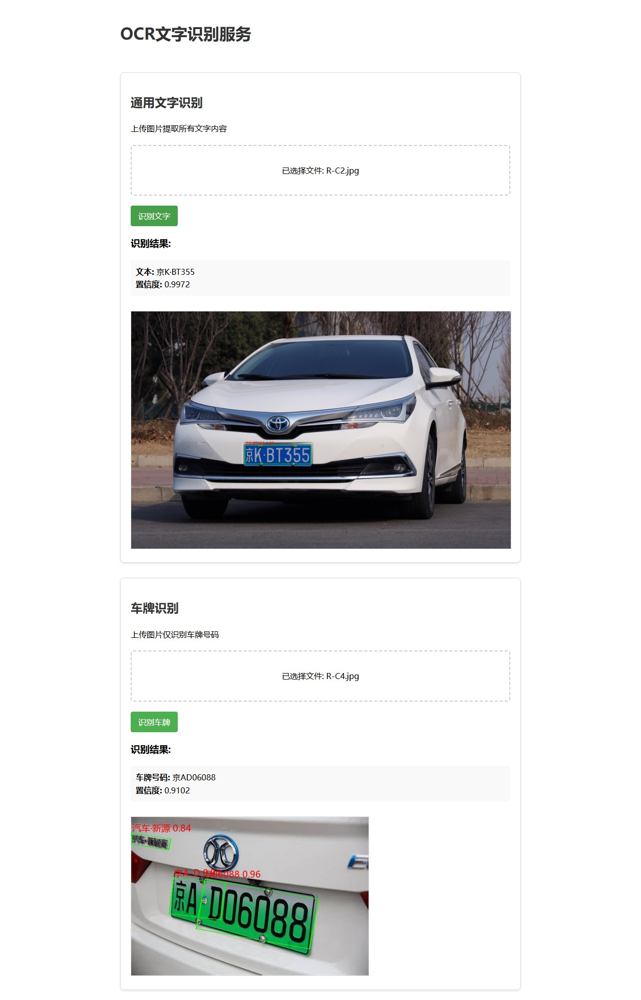
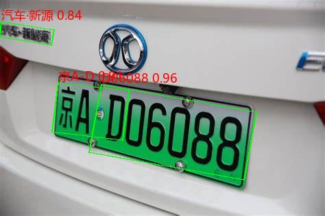

# 中文 OCR 文字识别与车牌识别服务

基于 **Flask + PP-OCR** 的中文图像识别服务，提供网页上传界面和命令行批量两种使用方式。既能识别图片里的全部文字，也能从照片中定位并提取中国车牌号码。



## 功能

- **通用文字识别**：上传任意图片，返回图中所有文本、置信度和坐标框
- **车牌识别**：从车辆照片中筛出车牌号码，自动处理分隔符与检测框切分
- **结果可视化**：识别结果自动绘制标注框并保存为图片，在页面上直接展示
- **命令行批量模式**：读取 `test.txt` 中的图片列表，一次性批量识别
- **双引擎自动降级**：优先使用 PaddleHub，环境不可用时自动切换到 RapidOCR

## 技术栈

| 组件 | 说明 |
| --- | --- |
| Flask | Web 服务与文件上传接口 |
| PP-OCR（RapidOCR / PaddleHub） | 中文文本检测 + 识别模型 |
| OpenCV | 图像读取与绘制 |
| Pillow | 中文标注文字渲染 |
| NumPy | 图像数组运算 |

> 原始版本使用 `paddlehub.Module("chinese_ocr_db_crnn_mobile")`。由于 PaddleHub 2.x 已停止维护、模型仓库与 PaddlePaddle 3.x 不兼容，本项目默认使用 **RapidOCR**（PP-OCRv4 导出为 ONNX，同属百度 PP-OCR 模型系列），并通过适配层保持与 PaddleHub 完全一致的调用接口。

## 目录结构

```
AI_ocr/
├── app.py              # Flask 服务入口，提供页面与两个 API
├── main.py             # 命令行批量识别入口
├── ocr_engine.py       # OCR 引擎适配层（PaddleHub 兼容接口）
├── plate_utils.py      # 车牌文本归一化、校验、检测框合并
├── templates/
│   └── index.html      # 单页前端（通用 OCR + 车牌识别）
├── image/              # 示例图片
├── requirements.txt
└── start.bat           # Windows 一键启动脚本
```

## 快速开始

```bash
# 1. 创建虚拟环境（建议 Python 3.10+）
python -m venv .venv

# 2. 激活
# Windows
.venv\Scripts\activate
# macOS / Linux
source .venv/bin/activate

# 3. 安装依赖
pip install -r requirements.txt

# 4. 启动服务
python app.py
```

打开 <http://127.0.0.1:5000> 即可使用。Windows 下也可以直接双击 `start.bat`。

命令行批量模式：

```bash
python main.py
```

图片路径写在 `test.txt` 里，一行一个（支持相对路径，按项目目录解析）。

## API

### `POST /api/ocr` 通用文字识别

```bash
curl -X POST -F "file=@image/R-C2.jpg" http://127.0.0.1:5000/api/ocr
```

```json
{
  "texts": [
    {
      "text": "京K·BT355",
      "confidence": 0.9972,
      "text_box_position": [[504, 591], [794, 591], [794, 674], [504, 674]]
    }
  ],
  "result_image": "ocr_result/ndarray_1795492313.949162.jpg"
}
```

### `POST /api/license_plate` 车牌识别

```bash
curl -X POST -F "file=@image/R-C4.jpg" http://127.0.0.1:5000/api/license_plate
```

```json
{
  "license_plates": [
    {
      "text": "京AD06088",
      "confidence": 0.9102,
      "text_box_position": [[76, 120], [373, 120], [373, 263], [76, 263]]
    }
  ],
  "result_image": "ocr_result/ndarray_1795492312.3432891.jpg"
}
```

标注图通过 `GET /results/<filename>` 访问。

## 车牌识别的两个细节

1. **分隔符归一化**：OCR 常把车牌读成 `辽A·2524N`，中间带圆点。匹配前会先去掉 `·`、空格、短横等字符并转大写，否则再准的识别结果也会被正则拒掉。
2. **检测框合并**：新能源绿牌等场景下，车牌可能被切成 `京A-D` + `D06088` 两个检测框。逐框匹配会漏检，因此增加了「同行相邻框合并 + 边界重复字符去重」的兜底逻辑。



## 示例结果

| 图片 | 识别结果 | 置信度 |
| --- | --- | --- |
| `image/R-C.jpg` | 辽A2524N | 0.9812 |
| `image/R-C2.jpg` | 京KBT355 | 0.9972 |
| `image/R-C4.jpg` | 京AD06088 | 0.9102 |

## 说明

- `ocr_result/` 与 `uploads/` 是运行时产生的目录，已加入 `.gitignore`
- 首次运行会自动下载 ONNX 模型（约 15MB），需联网
- 示例图片来源为公开车牌数据集，仅用于演示

## License

MIT
